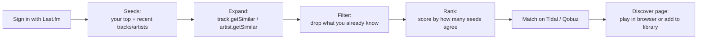

# Discovery

> Status: implemented on the `feature/discovery` branch. Code: `src/lib/lastfm.ts`, `src/lib/discovery.ts`,
> `src/app/api/{lastfm,discover,preview}`, `src/app/discover/page.tsx`, `src/app/components/Player`.

Discovery suggests music you haven't heard yet, based on what you listen to on Last.fm.
You can play every suggestion in the browser right away and add it to your library with one click.

Last.fm has no "recommended for you" API (it was shut down years ago), and it has no audio.
So Yoinker builds the recommendations itself from your listening history and the
similar-tracks data that Last.fm still provides. It then finds each suggestion on Tidal or Qobuz
so it can be played and downloaded.

## Overview



## 1. Signing in with Last.fm

Discovery uses Last.fm's web authentication flow, so it works with private profiles too
(those with "hide recent listening" turned on).

1. Create an API account at <https://www.last.fm/api/account/create> and set
   `LASTFM_API_KEY` and `LASTFM_API_SECRET` in `.env`. If they aren't set, discovery is hidden.
2. Clicking **Connect Last.fm** calls `GET /api/lastfm/login`. That redirects to
   `https://www.last.fm/api/auth/?api_key=…&cb=<origin>/api/lastfm/callback`.
3. You approve the request on last.fm, and Last.fm redirects back to `/api/lastfm/callback?token=…`.
4. The server exchanges the token for a session by calling `auth.getSession`.
   The call is signed with `api_sig`: the MD5 of the parameters, sorted by name and concatenated, followed by the secret.
5. The session (`{ name, key }`) is stored in an **httpOnly, SameSite=Lax cookie**
   (`Secure` over HTTPS). Last.fm session keys don't expire, so you only need to sign in once per browser.
   Nothing is written to the server.
6. `GET /api/lastfm/me` returns the username, or `null`, so the UI can show the connection state.
   There is no disconnect: to switch accounts, clear the `lastfm_session` cookie.

If OIDC login is enabled, the Last.fm routes stay behind it like every other API route.
Last.fm sign-in is separate from the OIDC login: it identifies *whose listening* to use,
not *who may use Yoinker*.

## 2. Seeds: what you listen to

Every Last.fm call below is signed with your session key (`sk`).

| Call | Used for |
|---|---|
| `user.getTopTracks` (period `1month`, ~50) | main track seeds |
| `user.getRecentTracks` (~50) | recent seeds, so the feed follows what you're into *now* |
| `user.getTopArtists` (period `3month`, ~20) | artist seeds for "Similar artists" |
| `user.getTopTracks` (period `overall`, up to 1000) | the "already known" set, used only for filtering |

Each seed gets a weight based on how much you play it, `log(1 + playcount)`, so that one
obsessive week doesn't take over the feed. Recent tracks without a playcount get a fixed weight.

## 3. Expanding: similar tracks and artists

- For each track seed, call `track.getSimilar(artist, track, limit=30)`.
  Every result has a `match` score from 0 to 1.
- For each artist seed, call `artist.getSimilar(artist, limit=20)`.

Last.fm asks clients to stay under about 5 requests per second, so calls run with a
concurrency of about 4. A full refresh is roughly 50–100 calls and takes a few seconds.

## 4. Filtering: only new music

A candidate is dropped if:

- it's in your "already known" set: your top 1000 tracks of all time, or your recent tracks;
- it's one of the seeds;
- it's already in your Yoinker library (`Downloader.IsTrackDownloaded`), once it has been matched (step 6).

Track identity is compared by a normalised `artist + title`: lower-cased, accents stripped, and
suffixes such as `(Remastered 2011)` or `- Radio Edit` removed. This catches the same song under slightly different names.

## 5. Ranking

The score of a candidate track `t` is:

```
score(t) = Σ over seeds s that suggested t:  weight(s) × match(s, t)
```

A track that several of your favourite songs point to ranks above one that a single seed
suggested strongly. Two rules keep the feed varied:

- **at most 2 tracks per artist** in the final list;
- similar artists are ranked the same way, and artists you already listen to (your top artists) are left out.

The top ~50 tracks and ~20 artists make up the feed.

## 6. Matching to Tidal / Qobuz

Last.fm only gives `artist + title`. To play or download a track, Yoinker searches
`musicRepository.searchTrack("<artist> <title>")` and picks the best result:

1. normalised title and main artist must both match;
2. prefer the original version: no `live`, `remix`, `acoustic` and similar, unless the Last.fm title has them too;
3. prefer Tidal when both providers have the track, because Qobuz allows only ~40 requests a minute.

Tracks with no good match are hidden, not shown greyed out.

Matching is the expensive step, so:

- tracks are matched **in batches of 10**: the first batch when the page opens, the next ones only when you click *Load more*;
- results are remembered in the **browser's localStorage** (`discover-matches`, at most 5000, oldest dropped
  first; "not found" for 7 days). A remembered track is not searched again; the page only asks
  `POST /api/discover/library` whether it is in the library now, which reads the music folder and uses no searches.
  A search that *failed* (e.g. rate-limited) is not remembered, so it is tried again next time.
- the server also keeps matches in memory until it restarts, shared by all browsers.

Similar artists are *not* matched upfront, because that would cost extra Qobuz requests. They are shown
as chips, and clicking one runs the normal artist search (`/?q=<name>&mode=artists`).

## 7. The Discover page

`/discover`, linked from the header:

- **Not connected:** a short explanation and a *Connect Last.fm* button.
- **Connected:**
  - *Tracks for you*: the ranked tracks, shown in the shared `MediaGrid`. Each card has a play
    button and the usual downloading and downloaded indicators.
  - *Artists you might like*: similar-artist chips, each showing which of your artists it came from.
  - A period selector (week / month / 3 months) for the seeds.
  - The signed-in Last.fm username.

The feed is cached on the server for 6 hours per Last.fm user, so opening the page again is
instant. A new feed is built after the 6 hours, or with *Try again* when building one failed.

`GET /api/discover?period=1month[&refresh=1]` returns the ranked, unmatched feed.
`POST /api/discover/match` takes a batch of up to 20 `{ artist, title }` and returns, for each,
`{ status: 'found', track }`, `{ status: 'missing' }` or `{ status: 'failed' }`.
The page leaves out tracks that are already in the library. A track you download from Discover shows the downloading spinner, but no checkmark afterwards.

## 8. Playing a discovered track

Playback is a separate feature, but discovery depends on it:

- `GET /api/preview?id=<trackId>&source=<tidal|qobuz>` resolves a stream URL through the
  provider and proxies it to the browser, forwarding `Range` so seeking works.
  It is a proxy because Qobuz needs Origin/Referer headers and the CDNs don't allow CORS.
- Previews stream at **320k lossy** (Tidal `HIGH` AAC, Qobuz MP3 320): they start fast, seeking works, and they play on
  iOS Safari. Downloads stay lossless.
- A player bar at the bottom of the screen stays visible on every page and shows artwork, title, artist,
  play/pause, a seek bar and an *Add to library* button.

## Configuration

| Variable | Required | Description |
|---|---|---|
| `LASTFM_API_KEY` | for discovery | API key from last.fm/api |
| `LASTFM_API_SECRET` | for discovery | Shared secret, used to sign `auth.getSession` and other calls |

When you register the API account, set its callback URL to `<your Yoinker URL>/api/lastfm/callback`.

## Limitations

- Discovery is only as good as Last.fm's similarity data. Niche artists with few listeners may get
  few or no suggestions.
- The "already known" filter only covers your top 1000 tracks plus recent ones. A song you played
  twice five years ago can still show up.
- Some suggestions aren't on Tidal or Qobuz and are left out.

## Possible later additions

- **Radio mode:** keep playing similar tracks after the current one ends.
- **Love on Last.fm** from the player (`track.love`; the session already allows it).
- **Scrobbling previews** (probably off by default, because a preview isn't really a listen).
